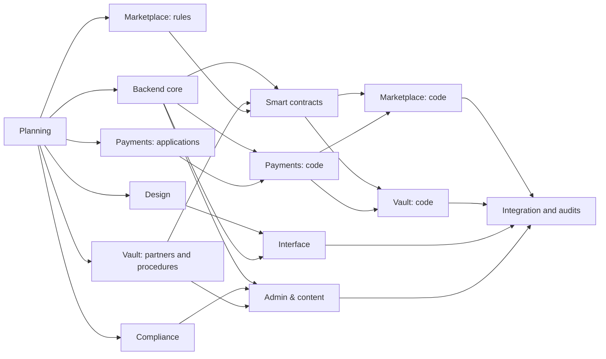

# Start here: chat starter kit

This kit starts every chat for the collectibles platform. Each chat gets two files: **`01-project-brief.md`**, shared by all chats, and its own starter file. The chat where you ran the research stays the **Planning** chat.

## How to start a chat

1. Open a new chat where the table below says: a chat inside your Claude Project, or a Claude Code session on the GitHub repo.
2. Attach `01-project-brief.md` and the chat's own file.
3. Paste the **First message** from the bottom of the chat's file.
4. When the chat finishes a task, it writes a handoff note. Paste that note into Planning, and Planning gives you the next task card.

## Your setup (Pro plan)

- **Claude Project for the document chats.** Create one Project, for example "Collectibles platform", in the Claude app. Add `01-project-brief.md` and the research report (`Web3 collectibles platform scope.md`) to its knowledge. Paste the project instructions below into its instructions. Run Design, Compliance and the planning parts of Payments, Vault & redemption and Marketplace inside it.
- **Claude Code for the code chats.** Run them at claude.ai/code or in the desktop app's Code tab, all on one GitHub repo. In its first task, Backend core commits this kit to `docs/briefs/`, so later code sessions read it straight from the repo.
- **Usage.** Every chat draws on the same Pro allowance, and parallel chats use it up fast; the research hit the limit twice. Run one code chat plus one or two document chats at a time. Consider Max before Wave 2, when several code chats should run together.

## What runs when

Chats in the same wave can run in parallel. A chat waits until everything in its **Needs first** column is done.

| Wave | Chat | Where | First task | Needs first | Can run in parallel with |
|---|---|---|---|---|---|
| Now | Planning | This chat | PLN-02 Workspace setup | Nothing | Everything |
| 1 | Design | Project chat, plus Figma if you use it | DES-01 Brand directions | Nothing | All Wave 1 chats |
| 1 | Compliance | Project chat | CMP-01 Launch policy | Nothing | All Wave 1 chats |
| 1 | Payments: applications | Project chat | PAY-01 Provider applications | Nothing | All Wave 1 chats |
| 1 | Vault & redemption: partners | Project chat | VLT-01 Custody and insurance quotes | Nothing | All Wave 1 chats |
| 1 | Marketplace: rules | Project chat | MKT-01 Sale rules | Nothing | All Wave 1 chats |
| 1 | Backend core | Claude Code | BE-01 Scaffold the repo | GitHub repo with the Claude GitHub App; Vercel team | The document chats |
| 2 | Smart contracts | Claude Code | SC-01 Contract design note | BE-02, VLT-03, MKT-01 | Interface, Admin & content, Payments code |
| 2 | Interface | Claude Code | INT-01 App shell | DES-02, BE-04 | Smart contracts, Admin & content, Payments code |
| 2 | Admin & content | Claude Code | ADM-01 Category schemas | BE-02, BE-04, CMP-04, VLT-03 | Smart contracts, Interface, Payments code |
| 2 | Payments: code | Claude Code | PAY-02 Payment interface | BE-03, PAY-01 | Smart contracts, Interface, Admin & content |
| 3 | Marketplace: code | Claude Code | MKT-02 Bid transaction | BE-03, PAY-02, SC-04 | Vault code, Interface |
| 3 | Vault & redemption: code | Claude Code | VLT-04 Redemption flow | SC-03, PAY-02 | Marketplace code, Interface |
| 4 | Integration | All code chats | End-to-end tests, audits | Every v1 flow on a Vercel preview | None |

What must happen in order:

- Backend core's BE-01 to BE-04 run one after another, and no other code chat starts before BE-01 is merged.
- Interface, Admin & content and the Payments code can build against mocks. Marketplace and Vault code need the real ledger, payment interface and contracts.
- Mainnet deployment waits until both audits close and you approve it.
- Packs, draws and the prediction contest stay off until a lawyer clears a market, and lawyers aren't funded yet.



## Gates Planning will ask you to confirm

- **Wave 1 to 2:** contracts C1–C9 at v0, design tokens published, launch policy v1.
- **Wave 2 to 3:** ledger holds, the payment interface and the token and escrow contracts working on Sepolia (Ethereum's test network) and in payment sandboxes.
- **Wave 3 to 4:** every v1 flow passes end to end on a Vercel preview.
- **Phase 1, closed beta:** audits closed, Taiwan gateway approved, vault insurance in place, and a Taiwan lawyer's view on the 7-day cancellation right for vaulted goods.

## Project instructions to paste

Paste this into the Claude Project's instructions. It runs to about 2,000 characters.

```text
Project: vault-and-redeem collectibles platform. Taiwan company, users worldwide.

Shared context: 01-project-brief.md (in project knowledge, and in the repo at docs/briefs/). Each chat also gets its own starter file. Read both before starting. The research report "Web3 collectibles platform scope" holds the evidence.

Repo: one GitHub monorepo (Turborepo + pnpm). Branch from main. One task = one branch = one draft pull request titled "[T-ID] title".

Contracts: build against the versions named in your task card (docs/contracts). Don't change a contract, a shared type or another chat's folder; put a change request in your handoff note instead.

Missing something (a decision, an API, a key, a design)? Say exactly what, and stop. Don't mock, substitute or guess unless the card says to.

Before saying done: tests and type checks pass, the Vercel preview works for anything users see, and a fresh-context review finds no gap against the card's "Done when". Show evidence.

Legal gates: packs, draws, the prediction contest and every chance feature stay off in packages/compliance until the launch matrix says Launch for that market. Never build paid raffles, staked betting, bid fees, fractional or yield-bearing tokens, or balances that hold users' money.

Ask the owner first before: production or mainnet deployments, Vercel environment or domain changes, spending money, contacting vendors or lawyers, publishing legal text.

Finish every task with a handoff note (template in 01-project-brief.md). In code chats, commit it to docs/handoffs/<T-ID>.md.

Conventions: TypeScript strict. Money in integer minor units; ledger unit USD = USDC; TWD shown as indicative. UTC timestamps; the database clock is authoritative. Every write goes through a domain command with an actor and an idempotency key. User-facing text in zh-TW, en and ja. Keep the chain invisible to users.
```

## Files in this kit

| File | Give it to |
|---|---|
| `00-start-here.md` | You |
| `01-project-brief.md` | Every chat |
| `02-planning.md` | Planning, if you ever restart it in a new chat |
| `10-backend-core.md` | Backend core |
| `11-design.md` | Design |
| `12-compliance.md` | Compliance |
| `13-payments.md` | Payments |
| `14-vault-redemption.md` | Vault & redemption |
| `15-marketplace.md` | Marketplace |
| `20-smart-contracts.md` | Smart contracts |
| `21-interface.md` | Interface |
| `22-admin-content.md` | Admin & content |
