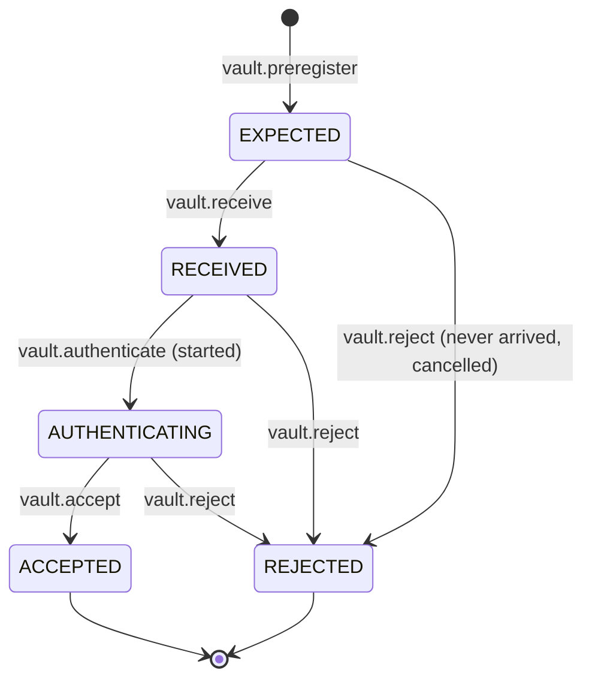
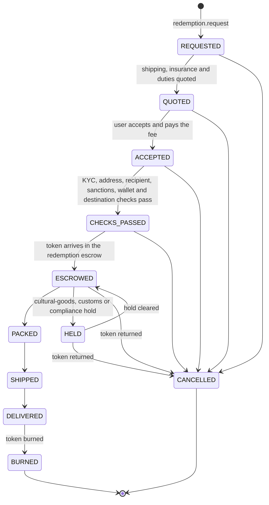

# C9 Vault item: intake record, item states and redemption steps

Vault & redemption · VLT-03 · 25 Oct 2026 · **Version 0.1.0, v0 draft.** Smart contracts, Admin & content, Payments and Interface may build against it with mocks. Planning approves every change, and freezes it as v1 before Wave 3 (PLN-04).

> **Source markers**, as in `docs/vault/README.md`: [S] means read through a search summary in this session, and [G] means general knowledge not checked. Smart contracts should check the token-standard details marked [S] against the EIP texts.

## 1. What this contract covers

| Covered here | Not here: who owns it |
|---|---|
| The intake record: what is recorded for each item on arrival | What the item is, attribute by category: C8 Catalog (Admin & content) |
| The vault item record: one physical item, its custody, value and token link | Tables, ID and money types: C1 Data model (Backend core). This spec says what C1 must hold |
| The item-to-token link | ABIs, addresses and the ChainAdapter: C4 Chain (Smart contracts) |
| The five item states, their transitions and lock reasons | The event envelope and channels: C3 Events (Backend core) |
| Moves between vaults | Payment rails and clearing periods: C5 Payments |
| The redemption steps, as a v0 outline that VLT-04 completes | Who may do what, where: C6 Launch policy (Compliance) |

## 2. Principles

1. **One physical item, one record, one token.** Never fractions, and never one token for several items.
2. **The database decides the item's state; the chain decides who holds the token.**
   - The indexer (SC-05) copies chain events into Postgres.
   - The daily reconciliation (VLT-06) compares the two and flags every mismatch.
3. **Every change is a domain command** with an actor and an idempotency key, in one database transaction, with the policy check (C6) inside. Every state change emits an event.
4. **Custody history is append-only.** A receipt, a move or a count is never edited; a correction is a new entry that points to the one it corrects.
5. **Fail closed.** An item with an incomplete record can't be accepted, listed or redeemed. A lock waiting for its chain transaction counts as locked.
6. **No personal data on chain.** No names, addresses or account IDs. Serial numbers appear only inside a salted digest (section 5.2).
7. **The chain stays invisible to users.** Users see "your vault" and "ownership record", never token IDs or addresses (section 6.3).

## 3. The intake record

One intake record per physical item, from pre-registration until it is accepted into the vault or rejected.

### 3.1 Intake statuses



- **ACCEPTED** creates the vault item (section 4) in state VAULTED and queues its token for minting.
- **REJECTED** records a reason and what happens to the goods (section 3.6). A rejected item never gets a token.

### 3.2 Pre-registration (EXPECTED)

| Field | Type | Required | Notes |
|---|---|---|---|
| `intakeId` | ID (C1) | Yes | |
| `siteId` | Site ID (section 8.1) | Yes | Where the item will arrive; normally `tw-hub` |
| `categoryId` | C8 category | Yes | Decides which identity, authentication and photo rules apply |
| `catalogRef` | C8 product reference | When the product exists in the catalog | For example the card, the watch reference or the sealed product |
| `expectedIdentity` | See section 3.4 | Yes | The cert number for a graded item; the serial or reference for a watch; the SKU or barcode for sealed products |
| `purchaseRef` | Text | Yes | Our purchase order or invoice |
| `purchaseCost` | Money (C1) | Yes | Used as the value until VLT-05 sets a fair-market value |
| `acquisitionChannel` | `own_stock` | Yes | Version 1 takes in our own stock only (D7). The launch policy calls this field `origin` (CMP-01); see section 13 |
| `expectedAt` | Date | No | |

### 3.3 Receiving (RECEIVED)

| Field | Type | Required | Notes |
|---|---|---|---|
| `receivedAt` | Timestamp | Yes | Database clock |
| `receivedBy` | Two staff IDs | Yes | Two different people; the command refuses one person twice |
| `unboxingVideo` | Media reference (section 3.5) | Yes | One continuous recording from sealed parcel to item on the table |
| `parcel` | Carrier, tracking number, seal intact (yes or no), notes | Yes | |
| `matchesPreregistration` | Yes or no, with notes | Yes | A mismatch doesn't block receiving, but blocks acceptance until resolved |

### 3.4 Authentication (AUTHENTICATING)

The method depends on the category, as VLT-02 will set out:

| Category | Identity recorded | Method | Evidence kept |
|---|---|---|---|
| Graded cards and other slabs | Grader and cert number | The grader's cert lookup, such as PSA's API, compared with the slab | The lookup response, its hash, and the time |
| Watches | Brand, reference, serial (kept as a digest, section 5.2) | LegitApp or Entrupy | The provider's certificate ID |
| Luxury bags | Brand, model, date code or serial (as a digest) | LegitApp or Entrupy | The provider's certificate ID |
| Sneakers | Brand, style code, size | LegitApp or Entrupy | The provider's certificate ID |
| Toys and figures | Grader and cert number when graded (AFA); otherwise maker, line, barcode | AFA, or our own check against the maker's reference | The cert ID or our check notes |
| Sealed trading-card products | Product, barcode, seal type | Our own seal and weight check against the maker's reference | Check notes and photos |
| Modern art and prints | Artist, title, year, edition number | The provenance file | The file reference (section 3.5) |

Each check records: `method`, `provider`, `providerRef`, `result` (`pass`, `fail` or `inconclusive`), `checkedAt` and `checkedBy`. An inconclusive result needs a second check before acceptance.

### 3.5 Recording (required for ACCEPTED)

| Field | Type | Notes |
|---|---|---|
| `media` | List of media references | The photo set for the category (VLT-02 sets the minimum), plus the unboxing video. Each reference holds the storage key, the SHA-256 of the file, the type, the time taken and who took it |
| `condition` | Grade or notes, by category | The grader's grade for slabs; our condition notes otherwise |
| `nfc` | Tag UID, chip type, where attached | Only where a tag is used. VLT-02 decides which categories carry one |
| `countryOfOrigin` | ISO 3166-1 alpha-2 | Where the item was made, not where it was bought. US duty follows it |
| `tariff` | `hs6`, plus national codes by country (TW, US and others as needed) | Recorded at intake, because every transfer and redemption needs it |
| `materials` | List | For example paper, steel, gold, leather, with the animal species when it's leather or another animal material |
| `cites` | Species, appendix, permit references | Only when a material is CITES-listed. Blocked materials are refused (section 3.6) |
| `provenance` | File reference; checks made (for example the Art Loss Register and INTERPOL ID-Art) | Required for art. `provenanceCleared` is set only by Compliance's process (CMP-04) |
| `value` | Money, with its source and date | The fair-market value (VLT-05). Until VLT-05 exists, the larger of purchase cost and last sale price |

**Acceptance needs all of these:**

- every required field for the category is filled;
- authentication passed;
- no mismatch with pre-registration remains open;
- the C6 item rules pass for `vault.intake`, using the C8 policy tags. For example, `antiquity`, `ivory`, `rhino_horn` and `tortoiseshell` are refused.

### 3.6 Rejection

| Reason code | When |
|---|---|
| `excluded_category` | The item carries a blocked policy tag (D6), or materials that imply one |
| `authentication_failed` | A check failed, or stayed inconclusive after the second check |
| `identity_mismatch` | The item doesn't match the pre-registration or its cert |
| `damaged_on_arrival` | Damage that the purchase terms let us refuse |
| `papers_missing` | CITES or other required papers are missing |
| `not_received` | The parcel never arrived, or the purchase was cancelled |

The rejection records what happens to the goods: `return_to_supplier`, `hold_for_claim` or `hold_for_authorities`. Goods are never destroyed by us.

## 4. The vault item record

Created when intake is accepted. One per physical item, kept forever, including after redemption.

| Group | Field | Notes |
|---|---|---|
| Identity | `itemId` | ID (C1). The token ID is derived from it (section 5.1) |
| | `intakeId` | The intake record it came from |
| | `categoryId`, `catalogRef` | C8 |
| | `identity` | From section 3.4. Cert numbers are kept as they are; serials only as a salted digest plus the last four characters for staff |
| | `itemDigest` | Section 5.2 |
| Physical facts | `media`, `condition`, `nfc`, `countryOfOrigin`, `tariff`, `materials`, `cites`, `provenance` | From intake. New media can be added; old media is never removed |
| | `provenanceCleared` | Boolean, set by Compliance's process only. The launch policy reads it (CMP-01) |
| Value | `fairMarketValue` | Money, its source and its date (VLT-05). **The insured value and the declared value are always this value**; there is no separate field to drift |
| Custody | `vaultCountry` | ISO alpha-2: `TW`, `SG` or `US`. The launch policy reads it (CMP-01). It changes only when a receiving count confirms arrival (section 8) |
| | `siteId` | Section 8.1 |
| | `position` | Box or shelf within the site. The evacuation manifest uses it |
| | `inTransit` | The transfer shipment ID, or empty |
| | `lastCountedAt` | The last count that confirmed the item (VLT-06) |
| Token | `token` | Chain ID, contract address, token ID, `mintStatus` (`queued`, `submitted`, `minted`, `failed`), mint transaction, mint time |
| State | `state` | Section 6 |
| | `locks` | The active lock reasons (section 7) |
| | `openRedemptionId` | Set while a redemption request is open (section 9) |
| Owner (derived) | `holderAddress` | From the indexer. Never written by a command |
| | `ownerType` | `platform` when a platform inventory address holds the token, `escrow` when the redemption escrow does, `user` otherwise, and `unminted` before the mint |
| | `accountId` | The user's account, when the holding wallet is linked to one. Empty when the token sits in an unlinked wallet |
| Bookkeeping | `createdAt`, `updatedAt`, `version` | Database clock. `version` guards against concurrent changes |

**Taiwan exposure** (`docs/vault/risk-limits.md`, section 3) is computed from this record:

- the `fairMarketValue` of items with `vaultCountry = TW` and `ownerType = user` or `escrow`, in any state except REDEEMED;
- plus the `fairMarketValue` of `platform` items with `vaultCountry = TW` in state LISTED.

Items in transit from Taiwan keep `vaultCountry = TW` until the Singapore count confirms them, so they still count.

## 5. The item-to-token link

### 5.1 Token ID

- **Proposed:** the token ID is the item's 128-bit UUID read as a `uint256`.
  - The ID is known before minting, so batches need no lookup table.
  - It reveals nothing about volumes, unlike a sequence number.
- **Smart contracts (SC-01) decides.** If it chooses something else, C9 records the mapping in `token.tokenId`.

### 5.2 The item digest

A commitment, written at mint, that ties the token to one physical item:

```text
itemDigest = SHA-256( JCS({
  itemId,
  categoryId,
  cert:          { grader, number }   // graded items only
  serialDigest:  SHA-256(salt ‖ serial) // items with a serial only
  mediaHashes:   [ SHA-256 of each intake photo and the unboxing video, sorted ]
  nfcUid:        tag UID                // tagged items only
}) )
```

- **JCS** is the JSON canonicalization scheme (RFC 8785), so anyone with the inputs gets the same digest [G].
- **The salt** is 32 random bytes per item, stored off chain. Without it, a short serial number could be guessed from its hash.
- **The digest never changes.** Media added later doesn't change it. If the item's identity changes, such as a card re-graded with a new cert, the old token is burned and a new one minted; that isn't supported in v0 (section 13).

### 5.3 What goes on chain

| Standard | What we put there | Notes |
|---|---|---|
| ERC-721 | One token per item; burned at redemption | |
| ERC-7578 properties [S] | `tokenIssuer`: the company's legal name. `assetHolder`: to be decided with counsel (section 13). `storageLocation`: a fixed program name, such as "lastfomo vault network (Taiwan, Singapore, US)", not the specific vault. `terms`: the URL and hash of the custody terms version. `jurisdiction`: `TW`. `declaredValue`: the fair-market value at mint, in USD | The ERC-7578 discussion recommends burning and re-minting when these properties change [S]. So nothing in them may change when an item moves between vaults or is revalued. The database's fair-market value is authoritative; the on-chain value is the value at mint |
| ERC-6982 [S] | `defaultLocked` is false. `Locked(tokenId, true or false)` when the item enters or leaves LOCKED | The reasons stay off chain (section 7) |
| ERC-4906 | `MetadataUpdate(tokenId)` when the vault country, the media shown or the state shown changes | |
| Token metadata (the token URI) | Name, one image, C8 display attributes, vault country, a link to the item page | Never the price, the owner, a serial number or anything personal |
| Item digest | Set once at mint | Where it lives (an ERC-7578 field, a mapping or the metadata) is SC-01's choice. It must be readable on chain |

## 6. Item states

### 6.1 The five states

| State | Meaning | Where the token is | Can be sold | Can be redeemed |
|---|---|---|---|---|
| **VAULTED** | In a vault, not offered for sale, not on hold. Ownership can be ours or a user's | Not minted yet, a platform inventory address, or the user's wallet | No (list it first) | Yes, if the owner is a user |
| **LISTED** | Offered for sale, at a fixed price or at auction | A platform inventory address (version 1: our own stock only) | Yes | No |
| **LOCKED** | On hold for one or more reasons (section 7) | Wherever it was, locked under ERC-6982 | No | No |
| **IN_REDEMPTION** | The owner asked for delivery and the token is in the redemption escrow | The redemption escrow | No | Already in progress |
| **REDEEMED** | Delivered to the owner. Terminal | Burned | No | No |

**Rules that always hold:**

- LISTED needs `mintStatus = minted`, so a sale can always transfer the token.
- An item has one state at a time. When several apply, the stronger one wins: REDEEMED, then IN_REDEMPTION, then LOCKED, then LISTED, then VAULTED.
- A LISTED item never goes straight to IN_REDEMPTION. It goes straight to LOCKED only when a sale settles on a rail with a clearing period; any other lock withdraws the listing first, in the same command.
- Nothing leaves REDEEMED.

### 6.2 Transitions

| From | To | Command (owner chat) | Preconditions | Chain effect |
|---|---|---|---|---|
| — | VAULTED | `vault.accept` (Vault) | Intake acceptance rules (section 3.5) | Mint queued for the next batch |
| VAULTED | LISTED | `catalog.publish_item` and the sale or auction scheduling commands (Admin & content, Marketplace) | Minted; `ownerType = platform`; no open redemption; C6 item rules pass; for a Taiwan-held item, the exposure guard allows new listings (`docs/vault/risk-limits.md`, section 3) | None |
| LISTED | VAULTED | Withdraw listing (Admin & content, Marketplace) | — | None |
| LISTED | VAULTED | A sale or auction settles, paid by USDC or a cleared rail (Marketplace) | Settlement confirmed on chain | Token transferred to the buyer |
| LISTED | LOCKED | A sale or auction settles, paid by card or another rail with a clearing period (Marketplace, Payments) | Settlement confirmed on chain | Token transferred to the buyer and locked in the same transaction (PAY-01's change request 5) |
| VAULTED | LOCKED | `vault.lock` (Vault, Payments or Compliance, by reason) | A reason from section 7 | `Locked(tokenId, true)` |
| LOCKED | LOCKED | `vault.lock` or `vault.unlock` for one reason while another stays | — | None |
| LOCKED | VAULTED | `vault.unlock` for the last active reason, or the system when a time-limited lock expires | No reason left | `Locked(tokenId, false)` |
| VAULTED | IN_REDEMPTION | The indexer sees the token arrive at the redemption escrow for an approved request (section 9) | `ownerType = user`; checks passed | Token moved into escrow by its holder |
| IN_REDEMPTION | VAULTED | `redemption.cancel` (Vault) | Not yet shipped | Escrow returns the token to the address it came from |
| IN_REDEMPTION | REDEEMED | `redemption.complete` (Vault, system) after delivery is confirmed | Delivery confirmed | Token burned. The state changes when the burn is final |

**Not allowed:**

- VAULTED to REDEEMED, without going through IN_REDEMPTION;
- LISTED to IN_REDEMPTION or REDEEMED;
- LOCKED to LISTED, IN_REDEMPTION or REDEEMED;
- IN_REDEMPTION to LISTED or LOCKED: a hold during a redemption is the request's HELD status (section 9), not a lock;
- anything out of REDEEMED.

An item in transit between vaults keeps its state, but a redemption waits until it arrives.

**Phase 2:** crypto peer-to-peer resale (launch matrix row 6) adds VAULTED to LISTED with `ownerType = user`. That needs a v1 change, approved by Planning.

**Concurrency:** every command locks the item row and checks `version`, as the brief's auction rule does for auction rows.

**Chain timing:**

- Transitions that follow the chain (IN_REDEMPTION, REDEEMED, and settlements) wait until the transaction is final. C4 sets how many confirmations count as final.
- Transitions that lead the chain (`vault.lock` and `vault.unlock`) write the state first and then send the transaction. While a lock transaction is pending, the item counts as LOCKED. An unlock takes effect only once its transaction is final.

### 6.3 What users see

Drafts for Interface and native review. The chain is never named.

| State | en | zh-TW | ja |
|---|---|---|---|
| VAULTED (user-owned) | In your vault | 保管中 | 保管中 |
| LISTED | For sale | 販售中 | 販売中 |
| LOCKED | On hold | 暫時保留 | 一時保留中 |
| IN_REDEMPTION | On its way to you | 配送處理中 | お届け手続き中 |
| REDEEMED | Delivered | 已送達 | お届け済み |

Our own VAULTED stock isn't shown to users. A LOCKED item shows the reason's user text from section 7, once Compliance (CMP-05) has written it.

## 7. Lock reasons

An item can hold several reasons at once. It stays LOCKED while any is active. On chain, the lock is a single flag.

| Reason | Set by | Cleared by | Ends |
|---|---|---|---|
| `card_clearing` | Payments, at settlement on a rail with a clearing period | The system, when the period ends | At a set time. PAY-07 sets the periods by rail and funding method |
| `payment_dispute` | Payments, when a chargeback or dispute opens | Payments, when it is resolved | When resolved |
| `compliance_hold` | Compliance: a screening hit, an investigation, or a request from the authorities | Compliance | When cleared |
| `custody_incident` | Vault & redemption: lost, damaged, under investigation, or the site unreachable (Level 3 in `docs/vault/risk-limits.md`) | Vault & redemption | When resolved. A permanent loss is an open item (section 13) |

Each lock records its reason, who set it, when, the end time if any, and a reference (dispute ID, case ID or incident ID).

## 8. Custody location and moves between vaults

### 8.1 Sites

| Site ID | Country | Custodian | Role |
|---|---|---|---|
| `tw-hub` | TW | Our staff, at the site chosen in VLT-01 | Intake, and items below the transfer threshold |
| `sg-vault` | SG | Brink's or Malca-Amit, chosen in VLT-01 | Items at or above the threshold; all watches, luxury goods and art |
| `us-satellite` | US | PSA Vault or Brink's US (Phase 2) | Graded cards bought in the US |

Sites are reference data. Adding one is a change to this contract.

### 8.2 A move

1. **`vault.transfer.dispatch`** creates a shipment with a manifest: the items, their values, origin and tariff codes. It sets `inTransit` on each item. `vaultCountry` doesn't change yet.
2. **`vault.transfer.receive`** records the receiving count at the destination. For each item that matches, it sets `vaultCountry` and `siteId` to the destination and clears `inTransit`. It then emits `MetadataUpdate` for those tokens.
3. **Any item missing at the count** gets a `custody_incident` lock.
4. **During a move:** items can still be sold, since a sale changes the owner, not the shelf. A redemption request waits until the item arrives.

`vault.relocate` records a move between positions within one site. `vault.count.record` records a custodian's count and its signature reference for the proof of reserve (VLT-06).

## 9. Redemption steps (v0 outline)

A redemption request is its own record, linked to the item through `openRedemptionId`. VLT-04 completes the steps, the fees and the shipping rules.



- **The item's state** stays VAULTED until ESCROWED, is IN_REDEMPTION from ESCROWED until the burn, and becomes REDEEMED at BURNED. CANCELLED after ESCROWED returns it to VAULTED.
- **The policy check** is C6's `vault.redeem`, run at CHECKS_PASSED. It checks the user's jurisdictions and the delivery country, and requires the recipient to be the verified account holder and the holding wallet to screen clear.
- **If the token leaves the requesting wallet before ESCROWED,** the request is cancelled. The checks were for the old holder.
- **A shipment lost or damaged after SHIPPED** is VLT-04's claims path. The token stays in escrow until it is resolved.
- **EU-bound art** goes to HELD for the cultural-goods check, and every US parcel gets a customs entry (VLT-04).

## 10. Commands and events

### 10.1 Commands (Vault & redemption, in `packages/core/src/vault/` and `src/redemption/`)

| Command | Actor | C6 action | Effect |
|---|---|---|---|
| `vault.preregister` | Operator | `vault.intake` | Creates an intake record in EXPECTED |
| `vault.receive` | Operator (two staff) | `vault.intake` | EXPECTED to RECEIVED |
| `vault.authenticate` | Operator | `vault.intake` | Records a check; RECEIVED to AUTHENTICATING |
| `vault.accept` | Operator | `vault.intake` | AUTHENTICATING to ACCEPTED; creates the item in VAULTED; queues the mint |
| `vault.reject` | Operator | `vault.intake` | Any open intake status to REJECTED |
| `vault.revalue` | Operator or system (VLT-05) | — | Sets a new fair-market value |
| `vault.lock`, `vault.unlock` | Operator or system, by reason | — | Section 7 |
| `vault.transfer.dispatch`, `vault.transfer.receive`, `vault.relocate` | Operator | — | Section 8 |
| `vault.count.record` | Operator | — | Records a custodian count (VLT-06) |
| `redemption.request` | User | `vault.redeem` | Opens a redemption request |
| `redemption.cancel` | User or operator | — | Section 9 |
| `redemption.complete` | System | — | REDEEMED after the burn is final |

Operator commands apply only the item rules of C6, as the launch policy says. The commands without a C6 action need one added before BE-05's check runs; see section 13.

### 10.2 Events (proposed names for C3)

- **Intake:** `vault.intake.expected`, `.received`, `.authenticated`, `.accepted`, `.rejected`.
- **Item:**
  - `vault.item.state_changed`, with `from`, `to`, the command and the reason;
  - `vault.item.locked` and `vault.item.unlocked`, with the reason;
  - `vault.item.revalued`;
  - `vault.item.dispatched` and `vault.item.received`;
  - `vault.item.counted`.
- **Token,** from the indexer: `vault.token.minted`, `vault.token.transferred`, `vault.token.burned`.
- **Redemption:** `redemption.status_changed`, with `from`, `to` and the reason.

## 11. What each chat builds against

| Chat | Builds against |
|---|---|
| **Smart contracts** (SC-01 to SC-05) | <ul><li>Section 5: the token ID, the digest at mint, the ERC-7578 and ERC-6982 mapping, metadata updates</li><li>Section 6.2: which transitions the chain leads and which it follows</li><li>Section 9: the escrow (receive from the holder, return on cancel, burn on delivery)</li><li>The indexer records `Transfer`, `Locked`, `MetadataUpdate`, the ERC-7578 events, and the escrow's events</li></ul> |
| **Admin & content** (ADM-01 onwards) | <ul><li>Section 3: intake screens per status, with the required fields per category</li><li>The listing preconditions in section 6.2, including the Taiwan exposure guard</li><li>C8 holds the policy tags; C9 holds the intake facts they're checked against</li></ul> |
| **Payments** | <ul><li>The lock reasons `card_clearing` and `payment_dispute`</li><li>Locking in the settlement transaction</li><li>The redemption fee (section 9)</li></ul> |
| **Interface** | <ul><li>The state labels in section 6.3</li><li>Which states users see</li><li>Never a token ID or address in user text</li></ul> |
| **Compliance** (C6) | `vaultCountry`, `provenanceCleared`, `acquisitionChannel` (the policy's `origin`), and the redemption check in section 9 |
| **Backend core** (C1, C3) | <ul><li>Tables for intake records, items, media, locks, sites, shipments, counts and redemption requests</li><li>The money and ID types</li><li>The event names in section 10.2</li></ul> |

## 12. TypeScript sketch (v0)

For the code chats to mock against. C1 replaces `Money`, `Id` and `Timestamp` with its own types.

```ts
type Id = string;                 // C1 decides; v0 assumes a UUID
type Timestamp = string;          // ISO 8601, UTC, from the database clock
type CountryCode = string;        // ISO 3166-1 alpha-2
type Money = { amountMinor: bigint; currency: 'USD' }; // C1 decides the minor unit

type SiteId = 'tw-hub' | 'sg-vault' | 'us-satellite';
type VaultCountry = 'TW' | 'SG' | 'US';

type IntakeStatus = 'EXPECTED' | 'RECEIVED' | 'AUTHENTICATING' | 'ACCEPTED' | 'REJECTED';
type RejectReason =
  | 'excluded_category' | 'authentication_failed' | 'identity_mismatch'
  | 'damaged_on_arrival' | 'papers_missing' | 'not_received';

type ItemState = 'VAULTED' | 'LISTED' | 'LOCKED' | 'IN_REDEMPTION' | 'REDEEMED';
type LockReason = 'card_clearing' | 'payment_dispute' | 'compliance_hold' | 'custody_incident';
type OwnerType = 'unminted' | 'platform' | 'user' | 'escrow';

interface MediaRef {
  key: string;                    // storage key
  sha256: string;                 // hex
  kind: 'photo' | 'video' | 'document';
  takenAt: Timestamp;
  takenBy: Id;
}

interface Identity {
  cert?: { grader: string; number: string };
  serialDigest?: string;          // SHA-256(salt ‖ serial), hex
  serialLast4?: string;           // for staff only
  reference?: string;             // watch reference, style code, SKU or barcode
}

interface Lock {
  reason: LockReason;
  setBy: Id;
  since: Timestamp;
  until?: Timestamp;
  ref?: string;
}

interface VaultItem {
  itemId: Id;
  intakeId: Id;
  categoryId: string;             // C8
  catalogRef?: string;            // C8
  identity: Identity;
  itemDigest: string;             // section 5.2
  media: MediaRef[];
  condition: string;
  nfc?: { uid: string; chip: string; attachedTo: string };
  countryOfOrigin: CountryCode;
  tariff: { hs6: string; national: Partial<Record<CountryCode, string>> };
  materials: { name: string; species?: string }[];
  cites?: { species: string; appendix: 'I' | 'II' | 'III'; permits: string[] }[];
  provenance?: { fileRef: string; checks: { name: string; ref: string; at: Timestamp }[] };
  provenanceCleared: boolean;
  acquisitionChannel: 'own_stock';
  fairMarketValue: { value: Money; source: string; valuedAt: Timestamp };
  vaultCountry: VaultCountry;
  siteId: SiteId;
  position: string;
  inTransit?: Id;                 // shipment ID
  lastCountedAt?: Timestamp;
  token: {
    chainId: number;
    contract: string;
    tokenId: string;              // decimal string of the uint256
    mintStatus: 'queued' | 'submitted' | 'minted' | 'failed';
    mintTx?: string;
    mintedAt?: Timestamp;
  };
  state: ItemState;
  locks: Lock[];
  openRedemptionId?: Id;
  holderAddress?: string;         // derived from the indexer
  ownerType: OwnerType;           // derived
  accountId?: Id;                 // derived, when the wallet is linked
  createdAt: Timestamp;
  updatedAt: Timestamp;
  version: number;
}

type RedemptionStatus =
  | 'REQUESTED' | 'QUOTED' | 'ACCEPTED' | 'CHECKS_PASSED' | 'ESCROWED' | 'HELD'
  | 'PACKED' | 'SHIPPED' | 'DELIVERED' | 'BURNED' | 'CANCELLED';
```

## 13. Open items

| # | Item | Who decides | v0 assumption |
|---|---|---|---|
| 1 | **A permanent loss.** An item lost for good, with the owner compensated, has no terminal state among the brief's five | Planning, with Smart contracts | It stays LOCKED (`custody_incident`). If v1 adds a terminal state such as WRITTEN_OFF, its token is burned with that reason |
| 2 | **ERC-7578 `assetHolder` and `storageLocation`.** Whether the "legal owner of the underlying asset" is the token holder or the company as custodian | Counsel (CMP-02), then Smart contracts | `storageLocation` is the fixed program name; `assetHolder` is left to counsel |
| 3 | **The token ID** | Smart contracts (SC-01) | The item UUID as a `uint256` |
| 4 | **Money and ID types** | Backend core (C1) | Section 12's placeholders |
| 5 | **The name `origin`.** The launch policy uses `origin` for the acquisition channel; intake uses `countryOfOrigin` for where the item was made | Compliance and Planning | C9 says `acquisitionChannel`, and the policy adapter maps it to `origin` |
| 6 | **Re-graded or re-slabbed items** | Vault & redemption, in v1 | Not supported: such an item is redeemed and taken in again |
| 7 | **C6 actions for operator commands** such as `vault.lock` and `vault.transfer.dispatch` | Compliance | The commands apply only the item rules until C6 lists them |
| 8 | **Finality:** how many confirmations count as final | Smart contracts (C4) | Ethereum's finalized block |
| 9 | **Which categories carry an NFC tag** | Vault & redemption (VLT-02) | None required in v0 |

## 14. Versions

| Version | Date | Change |
|---|---|---|
| 0.1.0 | 25 Oct 2026 | First v0 draft (VLT-03) |
