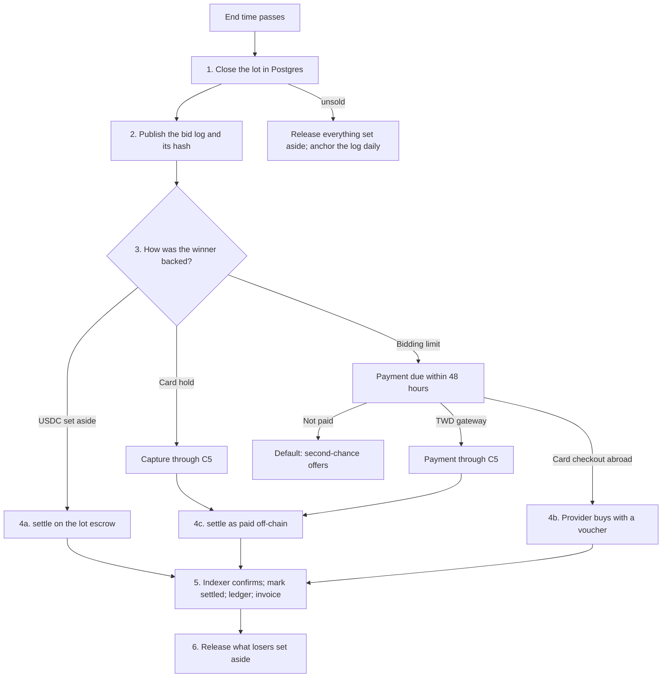

# Close and settlement

Marketplace · MKT-01 · 25 Oct 2026 · Version 0.1, draft

How a lot goes from its end time to "settled", and what Smart contracts (C4) and Payments (C5) need to build for it. The sale rules are in `sale-rules.md`; the events are in `events-and-channels.md`. Source markers are as in `sale-rules.md`.

## 1. The steps



| # | Step | Done by | Trigger | Idempotency key |
|---|---|---|---|---|
| 1 | **Close.** Lock the lot, check that the database time has reached the end time, and record sold or unsold, the winner, the winning bid and the premium. Start the payment deadline when one applies. Write `auction.closed` to the outbox | `auction.close`, system actor | A job scheduled at each lot's end time, plus a sweep every 15 seconds for any lot past its end | `close:{lotId}` |
| 2 | **Bid log.** In the same transaction, build the bid log (section 3) and store its hash on the lot. After the commit, publish the file | `auction.close` | Step 1 | `bidlog:{lotId}` |
| 3 | **Payment.** USDC set aside: nothing to do here; step 4a pays. Card hold: capture the all-in amount through C5. Bidding limit: send the payment request, then wait for C5's payment event or the deadline | `auction.record_payment` or `auction.mark_defaulted`, system actor | C5 webhook or deadline | The C5 payment ID; `default:{lotId}` |
| 4 | **Settle on-chain.** Through C4, one of the three paths in section 2. Each carries the bid log hash | `auction.settle`, system actor | Step 3 complete, or step 1 for USDC set aside | `settle:{lotId}` |
| 5 | **Confirm.** The indexer sees the settlement event at finality. Mark the lot `settled`, post the ledger entries (C5), ask Payments to issue the e-invoice, and write `auction.settled` | `auction.settle` (confirm phase) | Indexer event | The transaction hash |
| 6 | **Release.** Return what every losing bidder set aside. Batch it, with the platform paying the gas | `auction.settle` (release phase) | Step 1 | `release:{lotId}:{bidderCode}` |

Second-chance and post-auction offers (`sale-rules.md`, 7.4 and 7.5) settle like a fixed-price sale: the buyer pays at acceptance, through path 4b or 4c, or through a fixed-price USDC payment. Their settlement record names the sale kind and the bidder code.

## 2. The three settlement paths

| Path | When | What happens on-chain |
|---|---|---|
| **4a. Escrow settle** | The winner set aside USDC | The platform's settlement role calls `settle` on the lot escrow. It moves the all-in amount from the winner's deposit to the treasury, returns the rest of that deposit to the winner, and moves the item's token from our inventory to the winner. One event carries the lot ID, the winner, the winning bid, the premium and the bid log hash |
| **4b. Provider purchase** | The winner pays by card checkout abroad (Crossmint or Transak) | The provider calls the sales contract's purchase function with a voucher we signed (section 4, R9). The token goes to the winner and the clearing lock starts (PAY-07). The voucher carries the bid log hash, so the purchase event does too |
| **4c. Paid off-chain** | The winner paid through the TWD gateway, or a card hold was captured | The platform's settlement role calls a settle function with the payment reference's hash. The token goes to the winner. The clearing lock follows PAY-07's rule for card-funded items |

**Timing:**

- **Target:** within 1 hour of the close (path 4a) or of payment (paths 4b and 4c), batched.
- **Gas ceiling.** Smart contracts may defer a batch by up to 24 hours when gas is above a ceiling they set.
- **What the user sees.** From payment on, our records show the item as the winner's ("Yours"). Delivery and resale wait until settlement is confirmed.
- **Releases** (step 6) go out within 1 hour of the close, under the same gas rule. A bidder who was outbid can ask for their USDC back before the close (`sale-rules.md`, 6.1).

**Failures:**

- **A settlement transaction reverts or stalls:** retry with the same key, and alert the operator after three failures.
- **Finality:** a lot is `settled` only after the indexer sees the event at finality (Smart contracts set the confirmation rule).
- **The item can't be delivered** after payment, for example because damage is found before settlement:
  - refund on the same payment method;
  - the lot becomes `cancelled`;
  - nothing is minted or transferred.

## 3. The bid log

### 3.1 What it holds

The bid log is one JSON file per lot, published when the lot closes and never changed after that.

| Part | Content |
|---|---|
| Header | Schema version; lot, sale and item IDs; opening time, scheduled end, latest close and actual close; the opening bid; the rules in force (premium percentage, ladder version, soft-close window, cap) |
| Reserve | Either "no reserve", or the commitment published at opening plus the amount and salt that open it |
| Entries | One per lot event, in sequence order: each maximum bid, reserve lowered, bid voided, bidder removed, sale paused and resumed. Each has the sequence number, the database time in milliseconds, the bidder code, the resulting price, the leader, the reserve status and the end time |
| Result | Sold or unsold; for sold lots the winner's bidder code, the winning bid, the premium and the total |

**Amounts** are integers in the ledger's minor unit (C1); this file's examples use US cents.

**Pseudonyms:**

- **Codes.** Bidders appear as codes numbered in order of their first bid on that lot: B1, B2 and so on.
- **Per lot.** The codes start again on every lot, so nobody can follow one person across lots from the logs.
- **Your own code.** Each bidder sees their own code in their account.
- **What's left out:** the log holds no user IDs, names, wallet addresses or locations.

**Maximums:**

- **Losing bidders' maximums are published.** Anyone can then recompute every price from the rules.
- **The winner's maximums are withheld.** They appear as `null`. The resulting prices are still there and show that each maximum was at least the price.

### 3.2 Example

```json
{
  "schema": "bid-log/1",
  "lotId": "lot_01JC…",
  "saleId": "sale_01JC…",
  "itemId": "itm_01JB…",
  "amounts": "USD cents",
  "openedAt": "2026-11-02T03:00:00.000Z",
  "scheduledEndAt": "2026-11-09T12:00:00.000Z",
  "latestCloseAt": "2026-11-09T13:00:00.000Z",
  "closedAt": "2026-11-09T12:02:29.000Z",
  "openingBid": 10000,
  "rules": { "premiumPct": 20, "ladder": "1", "softCloseWindowSec": 120, "extendToSec": 120, "capSec": 3600 },
  "reserve": { "commitment": "0x9f2c…", "amount": 50000, "salt": "0x41d7…" },
  "entries": [
    { "seq": 1, "at": "2026-11-02T04:10:00.000Z", "type": "max_bid", "bidder": "B1", "maximum": null, "price": 50000, "leader": "B1", "reserveMet": true, "endAt": "2026-11-09T12:00:00.000Z" },
    { "seq": 2, "at": "2026-11-09T11:58:30.000Z", "type": "max_bid", "bidder": "B2", "maximum": 55000, "price": 55000, "leader": "B2", "reserveMet": true, "endAt": "2026-11-09T12:00:30.000Z" },
    { "seq": 3, "at": "2026-11-09T12:00:29.000Z", "type": "max_bid", "bidder": "B1", "maximum": null, "price": 60000, "leader": "B1", "reserveMet": true, "endAt": "2026-11-09T12:02:29.000Z" }
  ],
  "result": { "status": "sold", "winner": "B1", "winningBid": 60000, "premium": 12000, "total": 72000 }
}
```

This is example E5 from `sale-rules.md` with a US$500 reserve. B1's first maximum meets the reserve, so B1 leads at the reserve from the first bid (the reserve rule, `sale-rules.md` 4.5). The refused bid at 12:02:29 isn't in the log, because only accepted lot events are.

### 3.3 Hash, publication and anchoring

- **The hash** is keccak-256 over the UTF-8 bytes of the file in RFC 8785 canonical JSON. Keccak-256 is what the contracts use anyway.
- **Publication.** The file is served at a stable public URL, for example `/auctions/{lotId}/bid-log.json`. The lot page links to it as "Bid history". The settlement event carries the hash.
- **Reserve commitment.** It is keccak-256 over the ABI encoding of the lot ID, the reserve amount and a random 32-byte salt. It is published in `auction.opened` and on the lot page, and opened in the bid log.
- **Daily anchor (recommended for SC-01).** Unsold and withdrawn lots have no settlement transaction. Once a day, one transaction records a Merkle root of:
  - the reserve commitments of the lots that opened that day;
  - the bid log hashes of the lots that closed unsold or were withdrawn.

  That makes every reserve and every log tamper-evident for about one transaction a day.
- **Checking a log.** Recompute the hash and compare it with the settlement event or the anchor. Open the reserve commitment. Replay the entries through the rules: price, leader, reserve and end time must all match.

## 4. What the contracts must do (for SC-01 and SC-04)

Requirements, not a design: Smart contracts own the design in C4.

**Lot escrow (USDC set aside)**

| # | Requirement |
|---|---|
| R1 | A deposit is per lot and per bidder, in USDC, from the bidder's own wallet. Top-ups are allowed. Deposits never mix across lots, so a deposit is never a balance |
| R2 | A deposit needs an authorisation we signed (EIP-712) naming the lot, the bidder's address, a ceiling, the lot's latest close and an expiry. So only bidders who passed the policy check can deposit, and a screened-out wallet can't |
| R3 | Funds move only by `settle` (the winner's all-in to the treasury, the rest back to the winner) or `release` (everything back to the depositor). No function can send a deposit anywhere else |
| R4 | **Escape hatch.** Fourteen days after the lot's latest close, if the lot hasn't been settled, any depositor can withdraw their own deposit without us. Pausing never blocks this or `release` |
| R5 | `settle` takes the lot, the winner, the winning bid, the premium and the bid log hash, and emits them in one event. `settle` and `release` are callable only by the settlement role |
| R6 | Users never need ETH. We pay gas (for example through USDC `permit` with a relayer, or a paymaster); Smart contracts choose how |
| R7 | No interest, fees or yield on deposits, and deposits can't be used for anything else |

**Sales contract (fixed price, card checkout, second chance, off-chain-paid)**

| # | Requirement |
|---|---|
| R8 | The token for an item leaves our inventory once. A second sale of the same item reverts |
| R9 | **Vouchers.** A purchase in USDC, or through a card provider, needs a voucher we signed. It names: <ul><li>the item;</li><li>the amount in USDC;</li><li>the recipient, who may differ from the caller;</li><li>who may call it (anyone, or one provider);</li><li>an expiry and a nonce;</li><li>the sale kind (`fixed_price`, `auction_win`, `second_chance` or `post_auction`);</li><li>for auction kinds, the bid log hash.</li></ul>An expired or used voucher reverts. The expiry is never after the reservation's end (`sale-rules.md`, 9.2) |
| R10 | Card-provider addresses are allow-listed. A card-funded purchase starts the clearing lock on its own (PAY-01, change request 5) |
| R11 | The settlement role can record a sale paid off-chain: the item, the recipient, the sale kind, the bid log hash and a hash of the payment reference |
| R12 | The daily anchor (3.3), if adopted: one function that records a Merkle root and a date |

## 5. What Payments needs (for PAY-02 and PAY-06)

- **Holds:**
  - place one for a lot's all-in amount, in TWD with an exchange-rate buffer;
  - capture part of it at the close;
  - void it when the bidder is outbid or loses.
- **Payment requests for bidding-limit winners,** with a deadline, through the TWD gateway or card checkout. A webhook reports the result.
- **Per-transaction limits** for each rail and funding method, readable by the bid command (`sale-rules.md`, 6.3).
- **Ledger postings** (C5 with BE-03) for each step: hold placed, captured or voided; sale recognised, with the winning bid and the premium on separate lines so the invoice can show both; refunds.
- **Refunds on the same payment method** for cancellations within the 7-day right and for lots cancelled after payment.
- **The funding method** under `twd_gateway` (PAY-01, change request 7), so a TWD convenience-store or ATM payment can never pay for an item.
