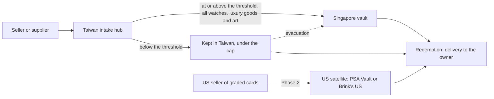

# Custody and insurance comparison

Vault & redemption · VLT-01 · 24 Oct 2026 · **a draft for the owner's budget; nothing has been sent to any vendor**

> **Source markers.** [P] is the vendor's own page or an official source, [S] is secondary, [G] is general knowledge not checked in this session, and [E] is a planning estimate with no source. This session read every web source through search-result summaries, because direct page fetches were blocked. Check each [P] and [S] fact on the live page before relying on it.

## 1. Recommendation in short

- **Singapore: ask Brink's and Malca-Amit for quotes in parallel.** Both run vaults inside Le Freeport, the customs-free zone next to Changi Airport [S].
  - **Brink's leads on fit.** It is the only candidate with its own vaults in all four places we need: Taiwan, Singapore, Hong Kong and the US [P][S]. It already holds the graded cards behind Courtyard's tokens, which is the same model as ours [S].
  - **Malca-Amit is the specialist** for watches, jewellery and art, and states that all its vaults are in free trade zones or bonded [P].
  - Choose on the quotes, using the scoring in section 8.
- **Hong Kong: get a price check only, and hold no user-owned items there at launch.** In a cross-strait crisis Hong Kong's risk rises with Taiwan's, so it shouldn't be where we evacuate to (section 5.2). This needs a ruling (finding 1).
- **Taiwan intake hub:** ask three kinds of provider for quotes:
  - a logistics operator inside the Taoyuan Air Cargo Free Trade Zone;
  - a bonded warehouse near Taoyuan Airport;
  - Brink's Taiwan's vault in Taipei, as the fallback.

  The free trade zone is the target. Imported stock pays no duty or business tax while it is there [S], it may settle the open export-tax question (finding 6), and it sits at the airport, so an evacuation flight is hours away. Which one wins depends on counsel's export-tax answer and the security survey.
- **US satellite (Phase 2):** ask PSA Vault whether it will open a business account for us and sign monthly counts. If it won't, use Brink's US. Nothing is spent on this in Phase 1.
- **Insurance:** appoint **one** Lloyd's broker after a short call with two of Gallagher, Howden and WTW. Then give that broker the request in `quote-requests/insurance-broker.md`.
  - **Recommended first call: Gallagher.** It has a London art, jewellery and specie team and has had its own Taiwan brokerage since December 2023 [S]. That matters because the Taiwan hub will probably need a Taiwan-licensed insurer (section 6.4).
  - Use one broker only: two brokers approaching the same underwriters block each other [G].
- **War:** expect no cover for war on land in Taiwan. The cap on user-owned value in Taiwan, the threshold for moving items to Singapore and the evacuation plan carry that risk instead (`risk-limits.md`).
- **Budget:** about **US$32,000–143,000 a year at US$1M** vaulted, falling to **0.6–2.3% of value at US$20M** [E]. One-off costs come to **US$15,000–60,000** [E]. Section 7 gives the assumptions. Fixed minimums dominate at Phase 1 volumes, and batching transfers is the largest saving.

## 2. Findings that need a ruling

1. **Hong Kong as the alternative (D8, brief "Custody").** The brief names Hong Kong as the alternative to Singapore. In a cross-strait crisis, Hong Kong's risk moves with Taiwan's:
   - The national security law lets the authorities freeze the assets of any person or company deemed a threat; Taiwan's Mainland Affairs Council called its 2021 use a warning to businesses [S].
   - Sanctions on mainland China could also tie up goods there [G].

   **Recommended:** Singapore is the only third-party vault for user-owned items. Hong Kong gets a price check only, and is revisited if Singapore capacity or prices fail. Planning decides; the brief's "Custody" line would change.
2. **The Singapore account opens before the first user-owned item is stored in Taiwan.** It is the evacuation destination, so it must already exist, with transfer paperwork agreed. That fixes Singapore's minimum fees from Phase 1, even when Phase 1 volume would fit in Taiwan alone. **Recommended:** accept this cost.
3. **War on land is not insurable for Taiwan in practice.**
   - Property insurers exclude war [G]. Political violence cover, which can include war, has been cut back for Taiwan since late 2022 [S].
   - War cover is easiest to buy for goods in transit by air or sea [G], and insurers can cancel it on 7 days' notice [S].
   - **So:** the owner sets the Taiwan cap and holds a reserve that could make users whole for a war loss in Taiwan up to that cap. `risk-limits.md` proposes US$1,000,000 for Phase 1.
4. **The Taiwan hub may need a Taiwan-licensed insurer.** Sources disagree on whether property in Taiwan can be insured by an unlicensed foreign insurer. One source says non-admitted placement isn't allowed at all; another allows only reinsurance written outside Taiwan [S]. The usual answer is a Taiwan insurer that issues the policy and reinsures it to Lloyd's [G]. The broker confirms this, and the Taiwan lawyer covers it under CMP-02.
5. **PSA Vault may not suit a tokenized platform.**
   - It is a consumer service. Its published terms cover sanctions and abandoned property [P], but the summaries this session could read say nothing on business accounts, signed counts or reselling ownership.
   - It may not sign the monthly counts the proof of reserve needs.
   - **Recommended:** ask PSA the questions in `quote-requests/psa-vault.md`; Brink's US is the fallback. Phase 2 only.
6. **Free trade zone and export tax.** The brief's open question asks whether an item sold abroad but kept in the Taiwan vault is a zero-rated export.
   - Goods brought from abroad into a Taiwan free trade zone for operations pay no import duty or business tax [S]. Goods leaving the zone into Taiwan's taxed area clear customs as imports [P].
   - Holding stock inside the zone may therefore give a cleaner answer than holding it in Taipei.
   - **Recommended:** add this to the Taiwan lawyer's export-tax question (CMP-02), and to Compliance's tax work (CMP-06).
7. **Exotic-leather watch straps.** The launch policy refuses delivery across a border for `cites_exotic_leather` items until the strap is swapped (CMP-01, section 9). Our model moves items across borders twice before delivery: seller to Taiwan, then Taiwan to Singapore. Each crossing needs CITES papers [S].
   - **Recommended buying rule:** buy watches without exotic-leather straps, or have the seller swap the strap before shipping.
   - Compliance confirms this in CMP-04.
8. **Who owns the item, and so whose loss the insurance pays.** Users own items through their tokens, while we hold the items. The custody contracts and the insurance must say so:
   - Items are held for the Taiwan company as custodian for the token holders, kept apart from the vault company's own assets.
   - The token holders are named as having an interest in the policy (a loss payee or bailee clause).

   This needs counsel (CMP-02).

## 3. How custody works in our model

- **Every item enters through the Taiwan hub** for receiving, authentication and recording (VLT-02).
- **Exception:** US-bought graded cards go straight to the US satellite from Phase 2.
- **After intake:**
  - Items at or above the threshold go to Singapore, and so do all watches, luxury goods and art.
  - Items below the threshold may stay in Taiwan, as long as user-owned value there stays under the cap.
  - The owner sets both numbers; `risk-limits.md` proposes defaults.
- **Our own stock stays where it is when it sells.** The sale changes the owner on the item record (C9), not the shelf.
- **Each location's custodian signs a monthly count**, and we reconcile tokens against the item records daily (VLT-06).

## 4. What the choice must satisfy

These come from the brief, the starter brief and the launch policy (CMP-01).

- **Insurance first.** No user-owned item is stored until vault insurance is in place. That is a Phase 1 gate.
- **The cap on Taiwan.** User-owned value held in Taiwan stays under the cap, and a written evacuation plan exists.
- **Proof of reserve.**
  - We need a custodian-signed count every month that we may publish.
  - We also need an item-level inventory we can reconcile daily, keyed by our item ID and the cert number.
- **Fail closed at redemption.** Redemption is the compliance control point (CMP-01, section 9). The custodian ships only on our instruction, and only after our checks pass.
- **One value per item.** The fair-market value from VLT-05 sets the insured and declared values. A carrier's liability can be limited to the declared value: Brink's contracts treat a declaration well below actual value as fraud, and in a 2022 dispute over a truck theft Brink's argued that under-declared goods were covered only up to the declared amount [S].
- **Origin and tariff code are recorded at intake** (VLT-02). They drive customs entries on transfers and at redemption, and US duty follows origin, not the vault's location.
- **Never taken in:** antiquities, ivory, rhino horn and tortoiseshell (D6). Exotic-leather straps follow finding 7.

## 5. Comparison by location

### 5.1 Singapore: the third-party vault

| | Brink's Singapore | Malca-Amit Singapore |
|---|---|---|
| Where | Three branches: Enterprise One (Kaki Bukit), Tai Seng and Le Freeport [S, undated] | Le Freeport, a 25,000 m² climate-controlled, high-security facility next to Changi Airport [P] |
| Tax status | Le Freeport is a customs-free zone [S]. Other Brink's sites: ask | Says all its vaults are in free trade zones or bonded [P] |
| What it stores | Precious metals, diamonds, jewellery and art, with independent inspection [P]. Watches and collectibles not named on the Singapore page: ask | Precious metals, luxury goods, fine art and rarities, duty-free while stored [P] |
| Units | Ask | From single safe deposit boxes to dedicated vaults [P] |
| Liability | Limited to the declared value per shipment, under its transport contract [S]. Vault terms: ask | Takes liability for goods it holds worldwide, under its service contracts, insured at Lloyd's and in the London market [P] |
| Network we'd use | Taiwan vault and armoured transport, Hong Kong, US [P] | A Taipei service centre opened in 2012 for temporary imports and secure transport [S]; whether it still runs is unconfirmed. Hong Kong vault at the airport [S]; New York facility [S]. No Taiwan vault found |
| Tokenized precedent | Vaults the graded cards behind Courtyard's tokens [S] | None found |
| Price | Not published | Not published. Resellers of its storage charge retail bullion clients 0.7–1.4% a year [S], far above what a business account pays [G] |

- **Other options in Singapore**, if both quotes fail:
  - **Fine Art Storage Services** rents private rooms, shared storage and viewing rooms inside Le Freeport [S].
  - **The Reserve** (Silver Bullion) is a newer vault that offers storage for watches, art and fine jewellery [S].
  - Neither runs its own transport network, so transfers from Taiwan would need a separate secure carrier.
- **Tax.** Goods kept in a free trade zone or a Zero-GST warehouse don't pay Singapore's import GST while stored. Sales while the goods stay in the warehouse ("in-bond" sales) carry no GST, and goods removed for export attract none [P]. GST falls due only when goods are released into Singapore [P]. Ask each vault which scheme its site uses.

### 5.2 Hong Kong: price check only

- **Brink's** advertises bonded warehousing and vaulting in Hong Kong [P]. In 2014 it applied, with a Hong Kong airport depository, for approval to store gold for a futures contract [S].
- **Malca-Amit's** Hong Kong vault is inside the airport compound and was described in 2012 as one of Asia's largest private vaults [S].
- **Tax.** Hong Kong charges no import duty except on liquor, tobacco, hydrocarbon oil and methyl alcohol, and has no GST [G]. So it needs no bonded status for our goods.
- **Why not for user-owned items:** see finding 1. In a Taiwan crisis, goods in Hong Kong may be the hardest to move. The quote requests ask for Hong Kong prices only as a benchmark.

### 5.3 Taiwan: the intake hub

| Option | What it is | For | Against |
|---|---|---|---|
| **A. Taoyuan Air Cargo Free Trade Zone** (the target) | An intake room inside the zone, rented from a logistics operator already licensed there. Applying to become a zone enterprise ourselves would come later | Goods from abroad pay no duty or business tax while inside [S]. It's at the airport, which helps evacuation. It may give a cleaner export-tax answer (finding 6) | Becoming a zone enterprise needs an operating plan and procedures for goods control, customs and accounts, then two approvals [S]. The zone targets value-added and logistics businesses [S]. Whether high-value goods and our filmed intake fit there: ask |
| **B. Bonded warehouse (保稅倉庫)** near the airport | A room or cage in a third party's bonded warehouse | Tax is suspended while goods are stored. Less licensing on our side | Storage time limits and rules for working on goods inside need checking against the current regulation, last amended 20 July 2026 [P]. Security standards vary by operator |
| **C. Brink's Taiwan vault** (the fallback) | Brink's high-security vault at its Taipei office, with armoured transport and customs clearance [P] | Fastest to start. One network from Taiwan to Singapore. Brink's cargo insurance covers goods it handles [P] | Inside Taiwan's taxed area: imports pay duty and the 5% business tax [G]. Business tax can usually be credited, but duty refunds on re-export depend on conditions and time limits we haven't checked [G]. Intake would happen in our own room nearby, with armoured transfers |
| D. Our own premises with our own safe | Not recommended | Full control | Security build-out, an insurer's survey, staffing and taxed-area friction, all for our first year |

- **Recommended:** ask A, B and C for quotes. For the VLT-02 dry run, use whichever is ready first; that will probably be C, because the dry run uses our own stock.
- **Decide** once counsel answers finding 6 and the broker sets the security requirements for the hub.
- **Climate and quakes.** Cards, art and toys need stable temperature and humidity; art storage guides target 45–55% relative humidity [S]. Taiwan is a high-earthquake and typhoon zone [G], so items sit in safes or secured cabinets, not on open shelving.

### 5.4 US satellite (Phase 2)

| | PSA Vault | Brink's US (fallback) |
|---|---|---|
| Where | New Castle, Delaware; 24/7 security; climate-controlled [S] | Ask |
| Storage | Free [S] | Ask |
| Leaving | US$1.99 per item, plus US$4.99 for items vaulted under 90 days, plus shipping (US$5.99 per US shipment) [S] | Ask |
| Selling | Integrated with eBay since PSA replaced eBay's vault in 2024 [S] | Not applicable |
| For a tokenized platform | Unknown: it is built for consumers. Its terms cover sanctions checks and abandoned property: an account with no activity for the period set by state law, typically three years, may be handed over to the state [P] | Precedent: Courtyard [S] |
| Signed monthly counts | Unknown; probably not offered to consumers [G] | Ask |

- **Customs into the US.** Cards are reported to enter as printed matter (4911.99.60) [S, forum]. Tariff questions belong to VLT-04 and Compliance.
- **Phase 2 only,** as the brief's phase list says. VLT-01 asks the questions now so the answer is ready.

## 6. Insurance

### 6.1 What the custodians already cover

- **Malca-Amit** takes liability for goods it holds, under its service contracts, insured at Lloyd's and in the London market [P].
- **Brink's** insures each shipment for its full declared value [P]. Its contract limits liability to that declared value [S].
- **What their cover leaves out, which our policy must fill:**
  - **Exclusions:** war, confiscation, nuclear, and often unexplained loss [G].
  - **Caps:** per-shipment or per-location limits [S].
  - **Time out of their hands:** the Taiwan hub, our own staff's handling, and carriers other than the custodians.

### 6.2 What our own policy must cover

One specie or fine-art policy, written as **stock and goods held for others** (bailee cover), with:

| Part | Detail |
|---|---|
| Insured | The Taiwan company, for its own stock and as custodian for token holders (finding 8) |
| Locations | The Taiwan hub, at full value. Singapore and the US: excess and difference in conditions over the custodian's liability |
| Transit | Taiwan to Singapore, redemption shipments, and returns. War and strikes covered in transit (6.3) |
| Perils | All risks, including earthquake, typhoon and flood in Taiwan; employee dishonesty; and unexplained loss where it can be bought |
| Valuation | An agreed value per item, from the VLT-05 fair-market value, with the schedule updated monthly |
| Limits | Per location, per shipment and per year. The Taiwan location limit should be at least the Taiwan cap plus our own stock there |
| Excess | The owner sets it; it trades against premium |
| Security conditions | The insurer's requirements for the Taiwan hub. Ask for these first, because they shape the hub choice |

### 6.3 War and political violence

- **On land:** standard property and terrorism forms exclude war, invasion and civil war. Only a full political violence policy reaches those perils [S].
  - Since the third quarter of 2022 insurers have cut back political risk capacity for China and Taiwan. Some exclude Taiwan from political violence policies altogether [S].
  - In January 2023 Lloyd's asked its members to measure their exposure to a blockade or invasion of Taiwan [S].
  - **Ask the broker for a political violence quote anyway.** Expect a refusal or a high price, and get the refusal in writing for the record.
- **In transit:** the Institute War Clauses (Air Cargo) cover war risks only once goods are loaded on the aircraft. Either side can cancel war cover on 7 days' notice, though shipments already under way stay covered [S].
  - **For the evacuation plan:** bind an open transit cover with war risks now, so cover is in place on the day goods move. Treat an insurer's notice of war-cover cancellation for Taiwan as an evacuation trigger (`risk-limits.md`).
- **Seizure:** a court has held a loss to be an excluded "seizure" even without violence [S]. Confiscation by a government is a separate political-risk product [G].
- **Market capacity outside Taiwan is healthy:**
  - Markel raised its Lloyd's fine art and specie line to US$250M in October 2026, naming collectibles [S].
  - Lloyd's Asia in Singapore hosts syndicates that write fine art and specie, such as Talbot's Syndicate 1183 [S].

### 6.4 Where the policy can be placed

- **Singapore and transit:** can be written in London or on the Lloyd's Asia platform in Singapore [S].
- **Taiwan:** sources disagree on whether an unlicensed foreign insurer may cover property in Taiwan (finding 4) [S]. Plan for a Taiwan insurer issuing the policy, with the risk reinsured to Lloyd's [G].
- **So choose a broker** that can place both. Gallagher has a Taiwan brokerage, opened December 2023 [S]. Howden, WTW, Marsh or Aon would need a Taiwan partner, or confirmation that one isn't needed.

### 6.5 Broker shortlist

| Broker | Why | Note |
|---|---|---|
| Gallagher | A global art, jewellery and specie team covering collectables, with specialists from the UK to Asia. A Taiwan brokerage since 2023 and a Singapore office [S] | Recommended first call |
| Howden | Lloyd's broker for fine art, specie and jewellery, with 40+ specialists [P] | Ask how it would cover Taiwan |
| WTW (Willis) | Fine art, jewellery and specie practice. Launched an Asian art insurance facility with Circle Asia [S] | Ask how it would cover Taiwan |
| Marsh, Aon | Large specie teams [G] | Reserves |

Brokers are usually paid by commission inside the premium [G]. Confirm there's no separate fee.

## 7. Costs for the budget

These are planning estimates [E], made without quotes, to give the owner a range for the D11 budget line "vault insurance and fees". The quotes replace them.

### 7.1 Assumptions

| Item | Low | High |
|---|---|---|
| Singapore storage | 0.10% of stored value a year, minimum US$6,000 | 0.30% a year, minimum US$24,000 |
| Singapore handling | US$10 per item movement | US$30 per item movement |
| Movements | Each Singapore item enters once and 30% leave each year; average Singapore item US$8,000 | Same |
| Taiwan hub storage and space | US$6,000 a year | US$30,000 a year |
| Our insurance (all locations and transit) | 0.15% of total value a year, minimum premium US$10,000 | 0.50% a year, minimum US$25,000 |
| Transfers from Taiwan to Singapore | US$1,000 per consolidated shipment, including customs brokerage at both ends | US$3,000 per shipment |
| Custodian-signed counts | US$200 a month per location (Taiwan, Singapore) | US$1,000 a month per location |

For comparison: a collectibles insurer's dealer policy for US$500,000 of cover was reported at about US$2,300 a year, about 0.46% [S]. One gallery charges storage insurance at 0.05% of declared value a month, about 0.6% a year [S].

### 7.2 A year at three sizes

Value held across all vaults; Taiwan holds part of it, the rest is in Singapore. US$ a year, rounded to the nearest thousand.

| | US$1M (Taiwan 0.2M) | US$5M (Taiwan 1M) | US$20M (Taiwan 2M, incl. own stock) |
|---|---|---|---|
| Shipments to Singapore per year | 4–12 | 12–24 | 24–52 |
| Singapore storage | 6,000–24,000 | 6,000–24,000 | 18,000–54,000 |
| Singapore handling | 1,000–4,000 | 7,000–20,000 | 29,000–88,000 |
| Taiwan hub | 6,000–30,000 | 6,000–30,000 | 6,000–30,000 |
| Insurance | 10,000–25,000 | 10,000–25,000 | 30,000–100,000 |
| Transfer cost | 4,000–36,000 | 12,000–72,000 | 24,000–156,000 |
| Signed counts | 5,000–24,000 | 5,000–24,000 | 5,000–24,000 |
| **Total** | **32,000–143,000** | **45,000–195,000** | **112,000–452,000** |
| As a share of value | 3.2–14.3% | 0.9–3.9% | 0.6–2.3% |

- **Minimums dominate at Phase 1 sizes.** Ask every vendor for its minimum fee and whether it falls in the first year.
- **Batch transfers** monthly, or when a batch reaches a set value, rather than item by item. Transfers are the largest swing in the table.
- **Not included:** our staff, authentication (VLT-02), price data (VLT-05), lawyers (CMP-02), and redemption shipping, which users pay (D9).

### 7.3 One-off costs

| Item | Estimate |
|---|---|
| Taiwan intake room security: a rated safe or secured cabinets, alarm with central monitoring, and CCTV that also films intake | US$15,000–60,000 [E] |
| Free trade zone enterprise application (option A, if we apply ourselves later) | Ask the zone operator |
| Custody contract review | Lawyers' budget (CMP-02) |

### 7.4 What users pay

Redemption is paid (D9). Shipping, insurance and duties are quoted to the user before they confirm (VLT-04). PSA Vault's withdrawal fee and shipping would be passed on the same way.

## 8. How to choose once the quotes arrive

Score each vault quote out of 100.

| Criterion | Weight | What good looks like |
|---|---|---|
| Liability and exclusions | 25 | Full declared value; a short exclusions list; named insurer; claims paid within a set time |
| Proof of reserve | 20 | Item-level inventory by our item ID, as an API or a daily file; a signed monthly count we may publish; auditor access |
| Network and evacuation | 20 | Its own transfers from Taiwan; a written priority-lift commitment for evacuation; customs at both ends |
| Price | 20 | Total over three years at the US$5M size, minimums included |
| Operations | 15 | Intake and dispatch times; photos on receipt; climate control for art and cards; viewing room; time to open the account |

For the broker, choose on how they would place the Taiwan location, their war and political violence answer, and how well they know collectibles.

## 9. Risks and open questions

- **No published prices.** No vendor publishes prices for this kind of storage, so section 7 is wide on purpose.
- **Undated facts.** Le Freeport's ownership changed in 2022, according to one report [S]. The Brink's branch list is undated [S]. Malca-Amit's Taipei centre may have closed [S].
- **PSA Vault for international accounts.** Forum reports conflict on whether non-US customers can use it, and PSA's February 2026 notice routes Asia-Pacific grading submissions differently [S]. This is a question for PSA.
- **Taiwan regulation.** The bonded-warehouse regulation was amended on 20 July 2026 [P]; storage limits and permitted work need checking against the current text. The rules for business tax on sales from the free trade zone to buyers in Taiwan weren't found [S].
- **Military activity.** The PLA's December 2025 exercise around Taiwan rehearsed a full blockade, with live fire inside the contiguous zone [S]. This informs the evacuation triggers.

## 10. Sources

Read through search-result summaries on 24 Oct 2026.

- Malca-Amit: vaults and free trade zone facilities, Singapore and Hong Kong pages (malca-amit.com) [P]; IDEX Online on the Taipei service centre, 2012 [S].
- Brink's: Singapore secure facilities (sg.brinks.com) [P]; Taiwan overview, vaulting, secure logistics and facilities (tw.brinks.com) [P]; Hong Kong bonded warehouses (hk.brinks.com) [P]; transport contract and declared-value clauses (brinksglobal.com, lawinsider.com) [S]; SBMA interview with Brink's Singapore [S]; JCK on the 2022 truck theft dispute [S].
- Le Freeport: The Reserve's history article and Fine Art Storage Services listing (agas.org.sg) [S].
- Singapore Customs and IRAS: Zero-GST warehouse scheme pages and the July 2025 handbook [P].
- Taiwan: Executive Yuan on the Taoyuan Air Cargo Free Trade Zone, 2023 [P]; Act for the Establishment and Management of Free Trade Zones, as summarised by the Presidential Office Gazette and KPMG [P][S]; Customs (Keelung) on clearance from the zone [P]; Regulations Governing Bonded Warehouses, amended 20 July 2026 (law.moj.gov.tw) [P].
- PSA Vault: Vault Terms of Service (psacard.com/vaultterms) [P]; Card Collector Capital and pregradecards.com on fees [S]; Sports Collectors Digest and EcommerceBytes on the Delaware facility and eBay [S]; Elite Fourum threads [S].
- Courtyard: Polygon case study and NEA blog [S].
- Insurance: Anderson Kill and Gen Re on political violence and war [S]; Reuters via Claims Journal, Insurance Business and Reinsurance News on Taiwan cover, August 2023 [S]; Institute War Cancellation Clause (Cargo) and Institute War Clauses (Air Cargo) texts [S]; Insurance Business on Markel, October 2026 [S]; Lloyd's Asia pages and Chaucer brochure [S]; Howden fine art, specie and jewellery page [P]; Gallagher art, jewellery and specie page and Taiwan brokerage news [S]; WTW and Circle Asia [S]; Legal500 and GlobalData on Taiwan insurance law [S]; Sports Collectors Digest on collectibles insurance rates [S]; HdM Gallery storage terms [S].
- Hong Kong: Taiwan News and AsiaNews on the 2021 asset freeze [S].
- Military activity: China Daily, Daily Signal and other reports on Justice Mission-2025 [S].
